<p align="center">
  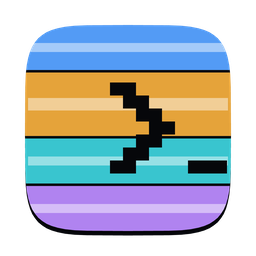
</p>

<h1 align="center">Terminescu</h1>

<p align="center">
  A macOS terminal manager for working in Claude Code all day.<br>
  Folders, tabs and split panes, saved commands, and a memory for every Claude session.
</p>

<p align="center">
  <a href="https://github.com/pantopix-ro/terminescu/releases">Download</a> ·
  <a href="https://claude.ai/artifact/9xWiUJnmsdS2z4aYauTGik">Interactive tour</a> ·
  <a href="docs/getting-started.md">Build from source</a> ·
  <a href="PRIVACY.md">Privacy</a>
</p>

<p align="center">
  <a href="https://claude.ai/artifact/9xWiUJnmsdS2z4aYauTGik">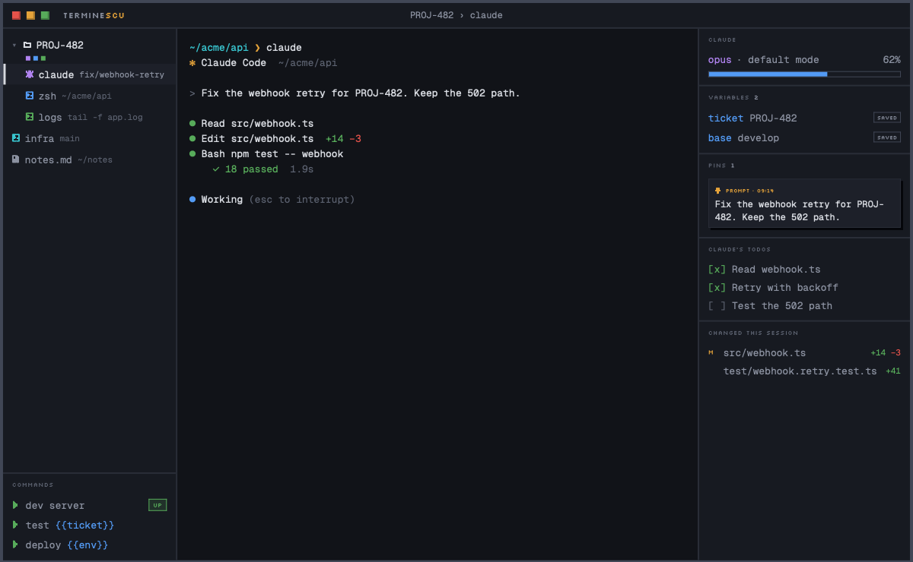</a>
</p>

You run five Claude sessions, a test watcher, a dev server and a log tail. One of them asks a
question and waits. In a plain terminal you find out ten minutes later. In Terminescu its row
turns amber, the title bar counts it and `⌘⇧A` takes you there.

Terminescu groups your terminals into folders, one per ticket or repo. Each folder remembers
what came out of its sessions: the PR link you copied, the line you pinned, Claude's todo list
and every file Claude changed. The next prompt or command fills itself from that context.

It doesn't drive Claude. You start every session yourself by typing `claude` in a shell, and
Terminescu never starts a turn on its own.

> **Status: pre-release.** macOS 14 or later on Apple silicon. The app isn't notarized by
> Apple yet, so the first launch needs one extra step (see [Install](#install)). The images on
> this page come from the [interactive tour](https://claude.ai/artifact/9xWiUJnmsdS2z4aYauTGik)
> and use invented data.

## What it does

### Folders, tabs and panes

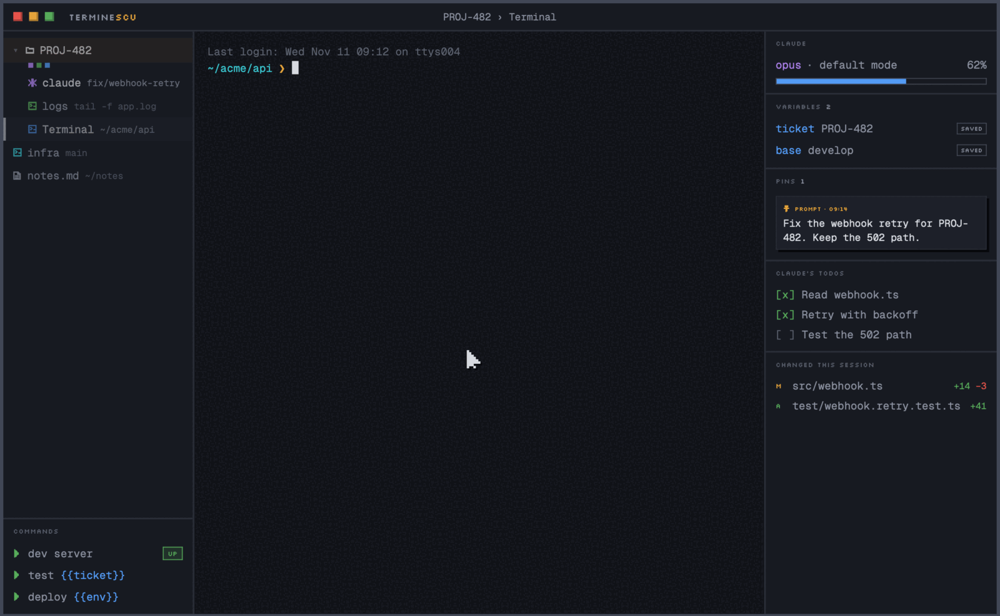

The sidebar holds your work. A row is one tab. Drag a row onto another and the two become a
folder, with a coloured square per tab. `⌘T` adds a tab to the selected folder, in the
folder's working directory. Every tab in a folder shares one context. New tabs open your login
shell, never `claude`.

Tabs move like browser tabs: drag one to reorder it, onto another row to move it, or outside
the window to open a new window. `⇧⌘T` reopens the last closed tab with its name, status,
variables and pins.

### Split panes, and two rows side by side

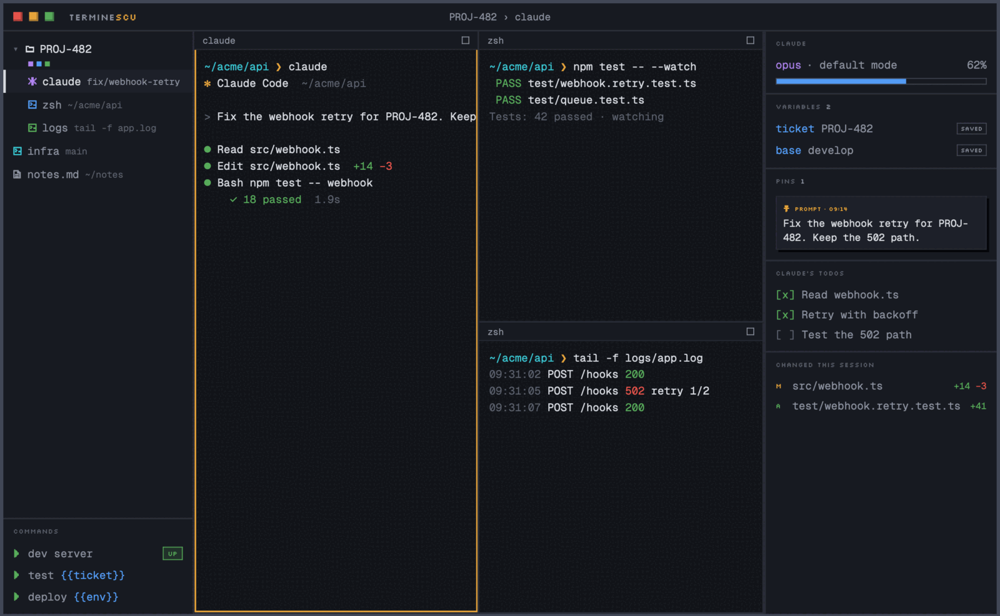

`⌘D` splits right and `⌘⇧D` splits down. `⌘⌥` and an arrow moves the focus, and `⌘⇧M` shows the
focused pane alone until you press it again.

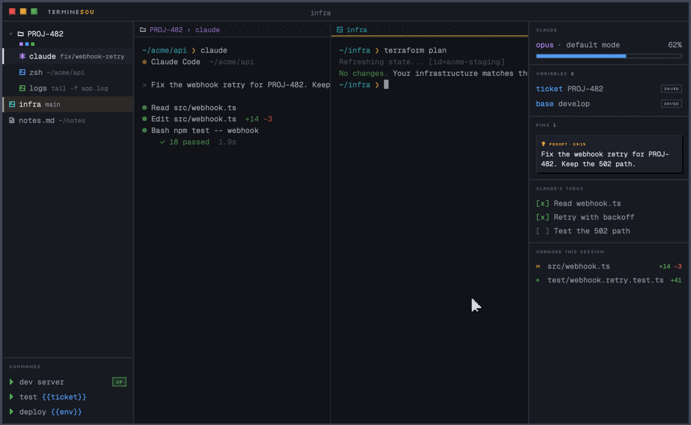

Drop a row, or a folder's tab, on a pane's edge and it shows beside the current one. Each
area keeps its own head and context, and the window remembers the view across restarts.

### Amber means it needs you

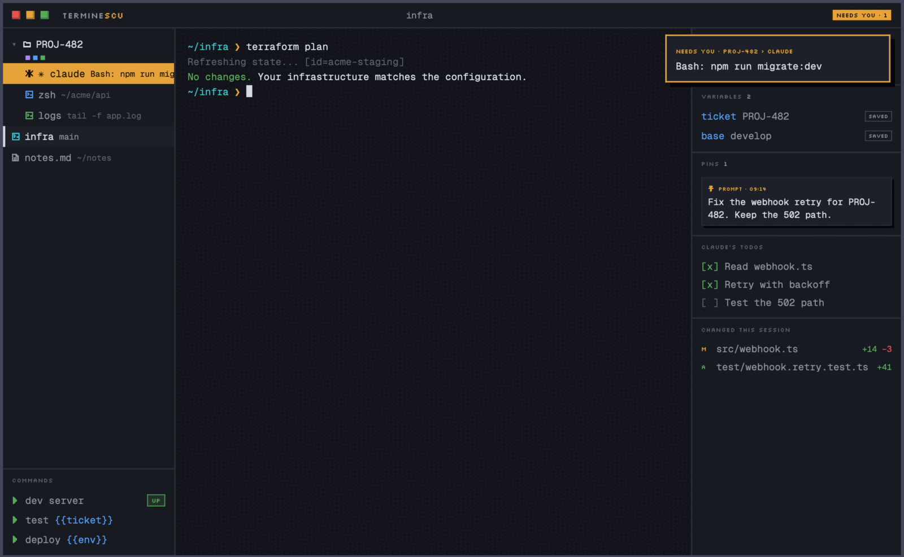

Claude Code hooks tell Terminescu when a session waits on you. Its tab gets Claude Code's ✳,
its row turns amber and names what it waits on. The title bar counts the waits, the dock icon
bounces and a notification goes out. `⌘⇧A` jumps to the oldest one. Answer it and the amber
clears.

Amber is reserved for this. Your own statuses, set by hand with `⌘⇧S`, by rules or by the
`terminescu status` CLI, pick from the other colours.

### Context per folder

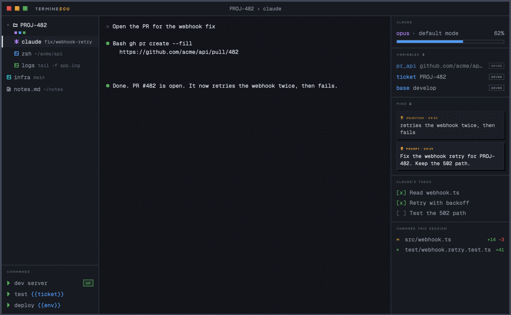

Select text in any pane. `⌘E` saves it as a variable and `⌘⇧P` pins it. The context panel shows
the folder's variables and pins next to Claude's model and context meter, its todo list and the
files it changed this session.

### Commands you save once

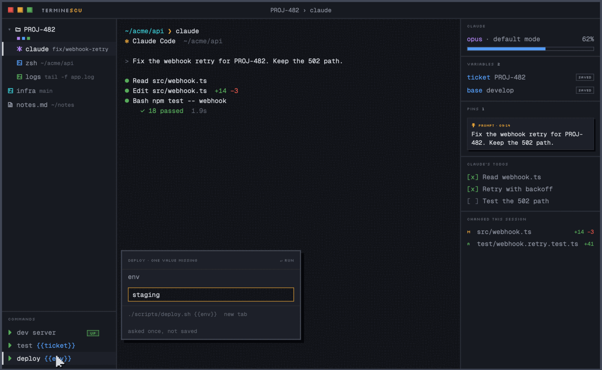

A command is a saved shell line with `{{variables}}`, kept in the sidebar. Run types it with
Enter into the focused pane, a new tab or a new row. Insert types it without Enter. A value the
context lacks is asked for once and never saved. A launcher, such as a dev server, shows UP or
DOWN and restarts in one click.

### And the rest

<table>
<tr>
<td width="50%">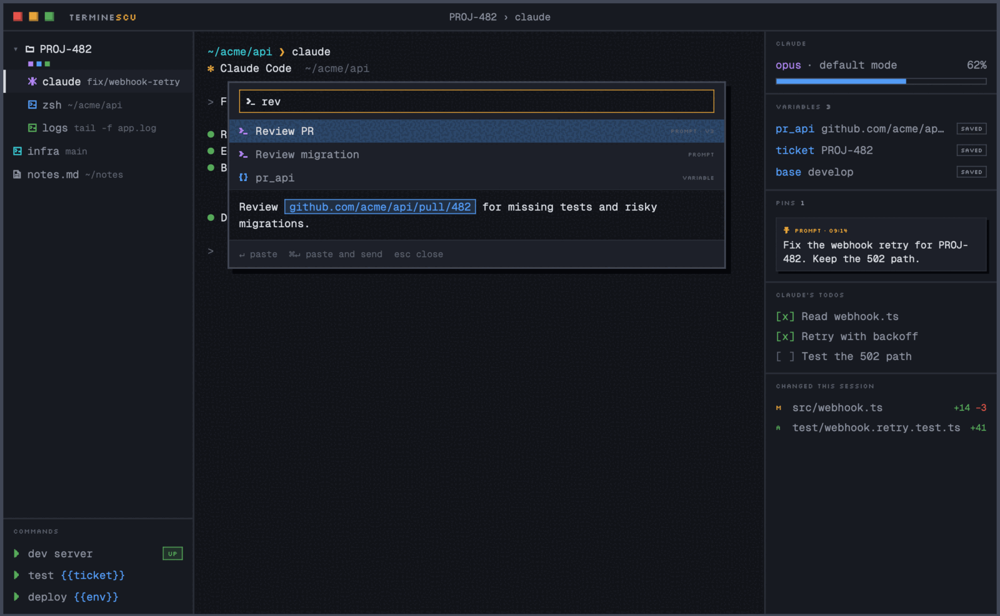</td>
<td width="50%">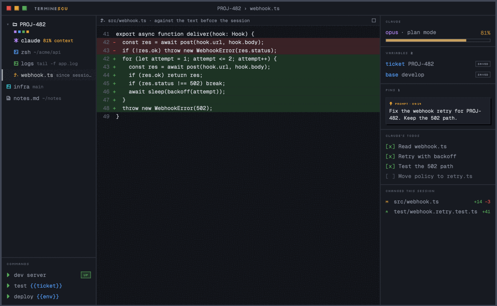</td>
</tr>
<tr>
<td><b>Prompts.</b> A versioned library with <code>{{variables}}</code>. <code>⌘I</code> fills one from the context and pastes it. It never presses Enter for you.</td>
<td><b>Claude insights.</b> The context meter turns amber at 80%. Each changed file opens as a diff against its text before the session. <code>⌥⌘R</code> resumes a past session.</td>
</tr>
<tr>
<td>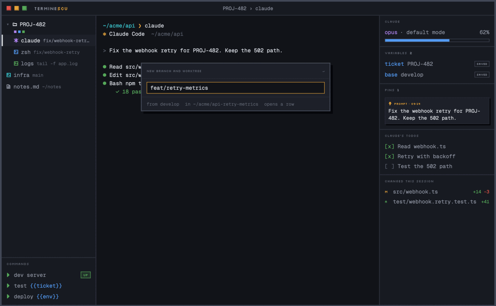</td>
<td>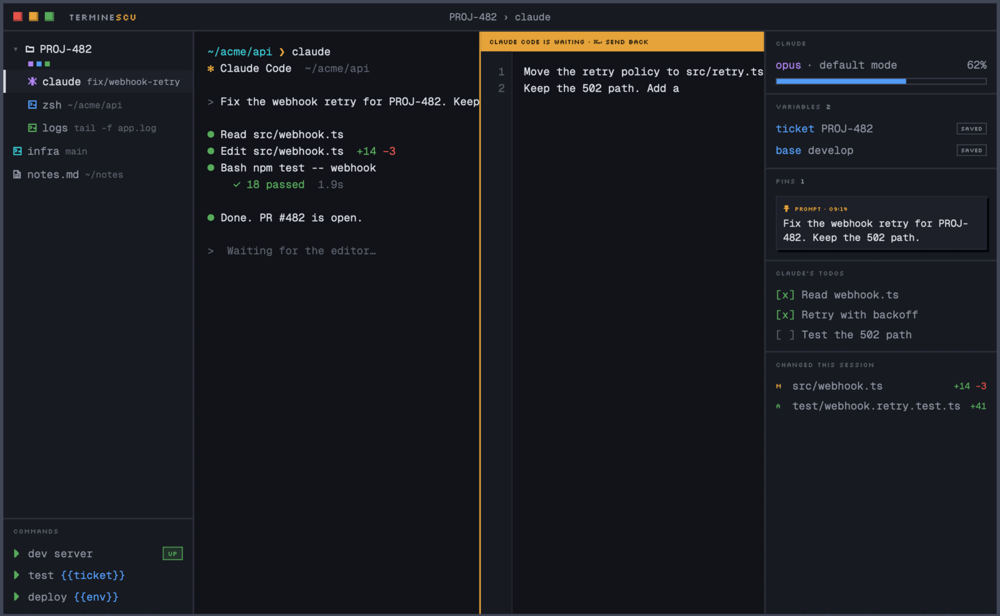</td>
</tr>
<tr>
<td><b>Git.</b> Each tab shows its branch and pull request. <code>⌥⌘N</code> makes a branch, a worktree and a row in it. <code>⌥⇧⌘G</code> checks out a pull request as a row.</td>
<td><b>Text tabs.</b> <code>⌥⌘T</code> opens a plain-text tab. Set <code>EDITOR</code> to <code>terminescu edit --wait</code> and Claude Code's <code>⌃G</code> opens beside the terminal.</td>
</tr>
</table>

**Secrets stay off disk.** `terminescu var set API_TOKEN --secret` keeps a value in memory only.
It shows masked and inserts as `$API_TOKEN`, so the value never lands in your scrollback.

**Quitting loses nothing.** A small daemon owns every shell, so sessions survive closing a
window, quitting the app and updating it. After a reboot the layout comes back with fresh
shells and a resume button for each Claude session.

## Keys

Plain keys always reach the terminal. App actions are `⌘` chords, and Settings › Keys rebinds
or turns off each one.

| Key | Action | Key | Action |
|---|---|---|---|
| `⌘T` | New tab | `⌘E` | Extract selection to variable |
| `⌘N` | New window | `⌘⇧P` | Pin selection |
| `⌘D` / `⌘⇧D` | Split right / down | `⌘I` | Insert prompt or variable |
| `⌘⇧M` | Maximize pane | `⌘⇧A` | Jump to waiting session |
| `⇧⌘T` | Reopen closed tab | `⌘⇧S` | Edit status |
| `⌥⌘T` | New text tab | `⌘P` | Command palette |
| `⌥⌘N` | New branch and worktree | `⌘⇧F` | Find in all panes |
| `⌃⌘1` to `⌃⌘9` | Switch row | `⌘1` to `⌘9` | Switch tab |

## Install

You need macOS 14 or later on Apple silicon, and Claude Code with a logged-in `claude`.

1. Download the `.dmg` from the newest [release](https://github.com/pantopix-ro/terminescu/releases).
2. Open it and drag Terminescu to Applications.
3. Double-click Terminescu. macOS says it "could not verify" the app, because Apple has not
   notarized this build. Close the warning.
4. Open System Settings › Privacy & Security. Under Security, click **Open Anyway** next to
   Terminescu, then confirm.

You do this once. On the first launch, Terminescu asks before it adds its hook to Claude Code's
settings. Help › Uninstall Terminescu Helpers removes the hook and the helpers again. A build
that carries the update key installs later versions through Terminescu › Check for Updates and
checks each one against that key first.

The git features need git 2.30 or later. Pull requests need a logged-in `gh`.

## Privacy

Terminescu runs on your Mac and sends no telemetry. Its only automatic network call is the
update check. The hook reads Claude Code's events and transcripts on your Mac, and secrets live
only in memory. It never reads or stores a Claude token. [PRIVACY.md](PRIVACY.md) lists
everything it reads and keeps.

## Build from source

```
pnpm install
pnpm dev                     # the app with hot reload
pnpm build --bundles dmg     # Terminescu.app and a .dmg, in target/release/bundle
```

[Getting started](docs/getting-started.md) has the tools and every step.
[Development](docs/development.md) covers the architecture, the plan, the repository layout
and the design system.

## Contributing

Issues and pull requests are welcome. Pull requests need a signed Contributor License
Agreement, which a bot asks for once. See [CONTRIBUTING.md](CONTRIBUTING.md).

## License

Terminescu is made by [PANTOPIX RO](https://pantopix.ro) and ships under the
[Functional Source License 1.1, Apache 2.0 future license](LICENSE.md) (FSL-1.1-ALv2). You may
read, run, change and share the code for any purpose except a product that competes with
Terminescu. Each release becomes Apache 2.0 two years after it ships. The FSL is not an OSI
open source license.

Terminescu works with Claude Code and is not affiliated with Anthropic.
