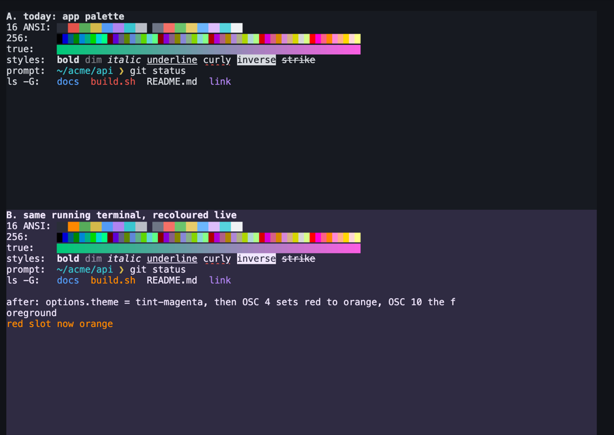

# Spike: colours in running terminals

Run on 2026-11-05 against the app's own stack: xterm.js 6.0.0 with the palette from
`packages/ui/src/xterm-theme.ts`, and the daemon's screen model and snapshot in `crates/ptyd`.
The prototype was a throwaway page that loads the same `xterm.js` and the same colour tokens.

**Result: the terminals already show colour. What is missing is colour by default and a way for
the person to choose it.**

## What works today

| Layer | State |
|---|---|
| Environment | The daemon starts each shell with `TERM=xterm-256color` and `COLORTERM=truecolor` (`server.rs`). |
| Renderer | xterm.js draws the 16 ANSI colours, the 256-colour cube, 24-bit colour, bold, dim, italic, underline styles with their own colour, inverse and strike. Terminal A in the picture. |
| Palette | The 16 ANSI slots come from the design tokens `ansi-0` to `ansi-15` (D16). |
| Programs | A program can set palette slots and the default colours with OSC 4, 10 and 11. The daemon keeps these changes and replays them on reattach (`snapshot.rs`, test at line 529). |

The prompt in the owner's screenshot is plain because the macOS default zsh prompt has no
colour, and BSD `ls` needs `CLICOLOR=1`. Terminal.app shows the same. `git`, `claude` and most
modern tools colour their output on a terminal without any setting.

## What the spike proved

1. **A running terminal recolours live.** Setting `term.options.theme` on an open terminal
   redraws it at once: no restart, the scrollback stays, and text already on screen takes the new
   colours. Terminal B in the picture switched to the magenta tint this way.
2. **Indexed colours follow the palette, 24-bit colours do not.** After OSC 4 set slot 1 to
   orange, every red cell turned orange, including old output. The truecolor bar kept its
   colours. A theme can therefore restyle `ls`, `git` and most prompts, but not tools that write
   RGB.
3. **A program's OSC change wins over the app theme** until the program resets it (OSC 104,
   110, 111). The app must not reapply its theme on top of it on every render.

## Options

| # | Option | What the person gets | Size |
|---|---|---|---|
| 1 | Colour on by default: the daemon sets `CLICOLOR=1` when the environment has none | Coloured `ls` and other BSD tools, with no change to the person's dotfiles | Small: one `env` call and a test |
| 2 | Side tab tint: the terminal background takes the side tab's status background (`tint-*` tokens) | Each side tab's terminals read as one group; the colour changes live with the status | Small to medium: a theme per pane from the shown status, set with `options.theme` |
| 3 | Terminal theme in Settings: a few palettes (Terminescu dark, a light one, a high-contrast one) | One choice applies at once to every running terminal in every window | Medium: a settings field, the presets as tokens, a Settings section |
| 4 | Opt-in coloured prompt from the shell integration, only when `PROMPT` is the macOS default | A cyan folder and an amber `❯`, as in the reel | Small, but it touches the person's shell, so it stays off by default |

Not worth doing: colouring output in the daemon (it would rewrite program output) and a
per-tab palette editor.

## Recommendation

Do 1 and 2 first. Option 1 is the cheapest fix for "the terminal looks plain". Option 2 uses
colour the app already has, so status and terminal agree. Option 3 can follow once a light UI
theme exists. Check contrast for option 2: `ansi-0` and `ansi-8` on the `tint-*` backgrounds
need the same check as the status chips.

## Open questions

- Should the tint fill the whole terminal background, or only a strip at the pane's top edge?
- Should option 1 also set `LSCOLORS` to match the palette, or keep the BSD default?
